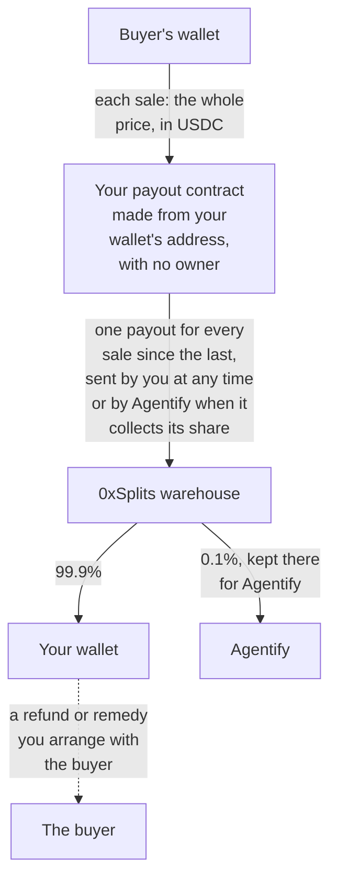

# Money

You run an online business, and you are deciding whether it is worth selling
to programs that buy on a person's behalf. The money side of that decision is
collected here: where the payments go, when your share reaches you, what you
risk on the way, and what we take.

## Where the money arrives

The buyer — a program, buying on behalf of a person — pays into your payout
contract: a smart contract on the Base network, made from your wallet's
address, which keeps the money until it is paid out and then sends 99.9% to
your wallet and 0.1% to Agentify. Nobody owns it. Neither Agentify nor anybody
else can change whom it pays or in what shares, and no account of ours holds
your money at any point. The money is USDC, which is issued by Circle, and
Circle can freeze USDC at any address, your payout contract and the shared
0xSplits warehouse it pays through included, for as long as the money waits
there.

A payout pays out everything that came in since the one before, so the sales
between two payouts reach your wallet as one transfer from the 0xSplits
warehouse rather than from a buyer. If your accounting is used to one line per
sale, there will be one line per payout instead, covering many sales, and
looking for your wallet's address on a buyer's payment finds nothing, because
the payment request a buyer pays against names your payout contract.

Saving your wallet costs nothing and writes nothing to the chain: the payout
contract's address follows from your wallet, and it can receive USDC from that
moment. The first payout puts the contract itself on the chain, and from then
on a block explorer shows its two recipients and their shares.

## Getting paid out

You can get paid out at any time, from the Settings screen of your dashboard,
which shows your payout contract and the one transaction that pays it out. A
Coinbase Wallet sends it from Settings once you approve it; any other wallet
that holds a little ETH for the network's fee and lets you paste data into a
transaction can send it too. Either way your share reaches your wallet in that
same transaction, which carries no money of its own and costs only the fee.
[Sending a payout](/payout) is the step-by-step for whoever holds the wallet.

If you never send one, your share arrives when Agentify collects its own,
because collecting it pays out every payout contract, yours included. There is
no fixed day for that, and until somebody pays it out, the money waits in the
contract.

## What they pay in

Buyers pay in USDC, a digital dollar whose rate is pegged to the dollar. A card
may write its price in USD or USDC; either way the buyer is asked for the same
number of USDC. There is no exchange-rate conversion in between, so a price in
any other currency is refused when the card is published. The test channel
uses Base Sepolia and test USDC, which is worth nothing; the live channel uses
Base and real USDC. Turning USDC into money in a bank happens outside
Agentify.

These payments are final. A buyer cannot reverse one the way a charge on a bank
card is reversed, because these payments have no such mechanism, so the case
where money is taken back off your account a month after the sale does not
happen here. Whatever you give back, you give back yourself and by your own
decision.

## When the money reaches you

The buyer is charged either after you have delivered or at the moment of
purchase, and you choose which product by product, in its card ([When your
buyer is charged](/#when-your-buyer-is-charged)). Either way the payment goes
into your payout contract, and your share reaches your wallet with the payout
after it.

One rule follows from that choice. While your answer comes before the money,
your silence costs the buyer nothing: if you do not deliver, the purchase did
not happen. After the charge, the same silence leaves the buyer without the
goods. Your policy and your agreement with the buyer decide the remedy; Agentify records that the order is unfulfilled. What that looks like in each
failure is on [What can go wrong](/failures).

## You delivered and the money did not arrive

This is possible for goods that are paid for after your delivery. We check the
payment first — the signature and the funds — then hand you the order, receive
the goods and only then execute the payment, and in that gap the funds can
leave the buyer's wallet for something else. The order tells you whether the
charge failed or its outcome is still unknown.

After the payment's response deadline, Agentify checks an unknown outcome
against chain evidence without charging again. While fulfillment remains open, a confirmed transfer releases
the goods already recorded; proof that the authorization expired unused or was
cancelled allows the buyer to try payment again. After merchant closure, verification records only the original payment outcome: no goods are released and no fresh payment is accepted. If verification is unavailable
or disabled, or the evidence conflicts, the payment stays unknown until its
outcome can be established. Recovery resumes after a restart and requires no
manual reconciliation or approval from you.

What it can cost you is the price of one sale, so the thing to weigh is how
expensive and how irreversible your delivery is: access you can revoke and a
parcel already on its way are worth different amounts to you. Sometimes nobody
can say whether the buyer was charged at all, and then taking back what you
gave out may be taking it from somebody who paid. Putting the money first
closes the case: for a product paid for ahead of the delivery you never
deliver anything unpaid.

## What proves a sale happened

A paid sale leaves a receipt when its goods are released or its parcel's
shipment is recorded. It records what was bought and for how much, with the
payment confirmed by the facilitator or verified from chain evidence. A test
receipt is marked and does not prove that real money moved. The sale price
stays unchanged after your price has moved. The Receipts screen of your
dashboard lists them, and what each field means is on
[Orders](/orders#the-receipt).

An unknown payment has no receipt. While fulfillment remains open, verified recovery can release goods already
held and write their receipt, using the payment's block time rather than the
recovery time. A paid order neither delivered nor shipped leaves no receipt,
including a late prepaid payment that leaves an unfulfilled order; what you have for
it is the original payment status and the unfulfilled order. Receipts therefore do not
account for all money received.

When the answer to a purchase is lost on the way and the agent repeats it, it
receives what was already delivered, with no second charge and no second
delivery asked of you.

## If the buyer did not get the goods

You decide cancellation and refund policy and arrange the remedy with the buyer. A refund may be partial, use another currency or network, or be replaced by another agreement. Those transfers and any fulfillment outside Agentify belong to your system. Agentify does not send the refund, verify it, or judge whether the parties have settled.

A missed delivery deadline establishes that the order was not fulfilled in time. It does not establish a whole-price refund obligation. The order records `unfulfilled`, the original price and payment status, and what caused delivery to stop. An accepted late delivery can still fulfill it until you close future Agentify fulfillment.

Close fulfillment from **Orders → Order details → Close fulfillment**, or through your integration, when Agentify should stop accepting delivery. You may explain the decision to the buyer. Agentify records "fulfillment closed by merchant" and attributes your explanation to you; a claim about a refund remains your statement. Closure does not move money or cancel work in your shop. It preserves the original payment and history. A payment already accepted for execution may still complete; its outcome stays unknown until verified. The [order reference](/orders#closing-fulfillment) explains the action and retries.

Agentify retains its 0.1% commission on the original payment. Neither the payout contract nor the shared warehouse returns it. A receipt records the original completed fulfillment and payment; it does not become a net balance or a refund receipt. Agentify has no staffed refund service and does not promise to reimburse the buyer from its own funds.

## What we take

We take 0.1% of every payment, and it is inside your price. The buyer pays the
price on your card and nothing on top of it, and your payout contract sends
99.9% of it to you and 0.1% to us. If you want what reaches you to be the
whole of a price you have in mind, raise the price on the card yourself. There
is no subscription and no monthly fee. The Settings screen of your dashboard
names the commission, and saving your wallet there is how you accept it.

The contract divides what has accumulated in it, not each sale on its own, and
rounds each share down to the smallest unit of USDC, a millionth of a dollar.
It also leaves one such unit behind on a balance rather than pay the network
fee of emptying it. So a payout gives you about 99.9% of what came in and
never more, and what the rounding leaves over is divided in a later payout.
For the same reason there is no exact commission to read off a single order.

## Your wallet

### If you have no wallet yet

Your wallet is an address on Base, the network these payments run on: `0x`
followed by forty letters and digits. If your business has none, the
dashboard's Settings make one with you: Create or connect a Coinbase Wallet
opens Coinbase's window over the page, where you create a Coinbase Wallet or
connect one you already have, and its address comes into the box, to be saved
when you press the button beside it. You manage that wallet at
[wallet.coinbase.com](https://wallet.coinbase.com).

The wallet is yours, and so is the way into it. Nothing leaves it without your
approval in Coinbase's window, and Coinbase keeps no copy of your passkey or of
a recovery key you create and cannot get you back in without them, so set up a
way back while you still can get in ([how Coinbase's recovery works](https://help.coinbase.com/en/wallet/getting-started/smart-wallet-recovery)).

Any other wallet app that supports the Base network, such as MetaMask, works as
well. It shows the address, which is what you enter in Settings, and a recovery
phrase, which stays with you and is never entered anywhere at Agentify:
whoever holds the phrase holds the money. On the test channel your wallet only
ever receives test USDC, so it needs no money of its own.

### Replacing your wallet

A new wallet comes with a new payout contract, and the old contract goes on
paying the old wallet. Whatever is already in it is paid out to the old wallet
only, whoever sends the payout: if somebody else may hold that wallet's keys,
it is theirs to collect, and if you have lost access to it, it is lost with it.

On the live channel a wallet you have already saved is not replaced at once,
because the wallet is the one setting that sends your money somewhere else,
and a dashboard session left open on another device could ask for a change.
Everybody who signs in to your merchant's dashboard is sent a message first,
saying the change was asked for and from which account's session, and the new
address takes effect forty-eight hours after the messages went out. Until then
buyers pay into the old contract, and your Settings screen shows the waiting
address, the moment it takes effect and a button that cancels the change,
which also signs every other session out. So if you can no longer trust the
old wallet, replace it at once and pause selling for those two days.

A change that cannot be announced to every account is not recorded at all, and
the dashboard says why. A message about a change that was then refused is safe
to ignore, because every message says the change takes effect only if your
Settings screen shows it waiting. The first wallet you save applies at once,
and on the live channel every account is sent a message about it afterwards.
On the test channel every change applies at once and nothing is sent.

## What is not settled yet

- How a buyer reaches your support to arrange a remedy outside Agentify.
- Who pays the network fee on a buyer's payment and how it sits against the
  price of the goods.
- Reconciling what came in against what was sold. Your wallet receives one
  transfer per payout, covering every sale since the payout before it, and
  nothing yet shows which sales a payout covered. A receipt follows the goods,
  so an order paid for and not delivered has none, and matching the payouts
  into your wallet against the orders is still yours to do by hand.
- Whether Coinbase Wallet lets you pay a payout's fee in USDC, as Coinbase
  says it does, what it shows on a first payout from a wallet that holds
  nothing yet, and whether wallet.coinbase.com shows the test channel's test
  USDC. None of these has been tried on the test channel.
- The written terms of the commission. Until they are published, saving your
  wallet on the screen that names the commission is the whole of how you
  accept it.
- Who counts as the seller on paper, what document your accounting receives for
  a sale and for our commission on it, and how a stablecoin payment is
  reported.
