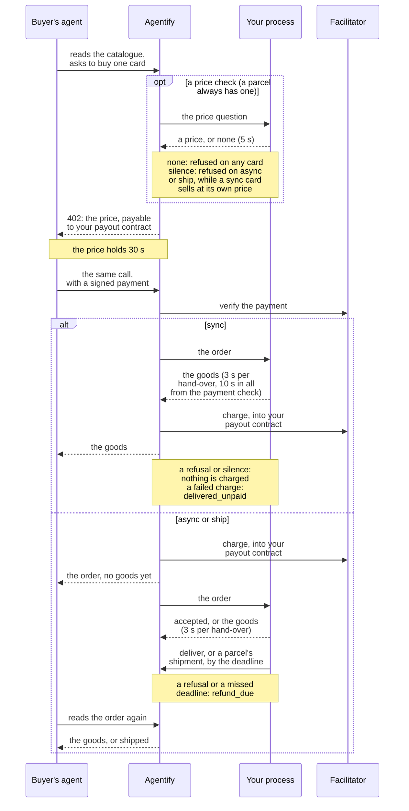
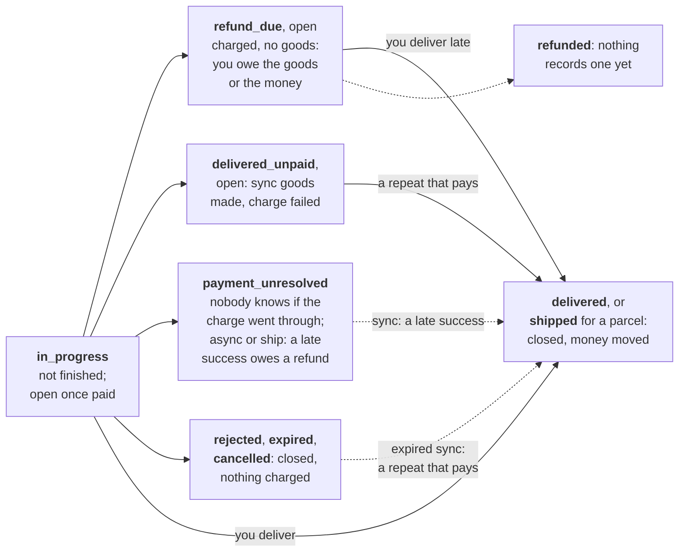

# Orders and fulfillment modes

*This page describes `@nuanu-ai/agentify` {{sdk-version}}. A change to the public contract arrives in a new package version.*

You are writing the handler that takes paid orders and gives out the goods for
them. This page is its reference: the fulfillment modes, where an order comes
from, what your handler answers, how an order can end, and every time limit
that applies to it. The working words — card, handler, idempotency key — are
defined on [The first test sale](/quickstart), and the failures are collected
in one table on [What can go wrong](/failures).

## Fulfillment modes

| Mode | When the buyer is charged | The goods reach the agent | If you refused or stayed silent |
| --- | --- | --- | --- |
| Synchronous, `'sync'` | after your delivery, as the last step | in the answer to the purchase | the purchase did not happen and the buyer spent nothing |
| Asynchronous, `'async'` | at the moment of purchase, before your delivery | later, by a separate call | the money is in your payout contract and the buyer has no goods: the order owes a refund |
| A parcel, `'ship'` | at the moment of purchase, before your shipment | with a carrier, once you record the shipment | as in the asynchronous mode |

The mode is declared in the card under `fulfillment`, and the agent knows it
before it pays. Three modes can be published today: synchronous,
asynchronous, and a parcel on the test channel only. A fourth, confirmation,
is designed and cannot be published. The product decides the mode; which one
yours takes is worked out on [The product card](/cards#goods-that-leave-later-than-the-answer),
and what the moment of charging means for the owner of the business is on
[Money](/money).

### A parcel

A parcel's order is the asynchronous one with an address in it and a shipment
at its end; what its card asks of you is on [Cards](/cards).

Your price handler is asked the price for the place the parcel goes: its
`ship_to` holds the country and the city, the state and the postal code where
the buyer gave them, and nothing about who receives it. Once the order is
paid, it reaches your handler with the whole address in `ship_to`: a name, the
first line, the city, the country and a phone number, and the second line, the
state and the postal code where the buyer gave them. Store the address before
you take the order on: the moment you answer `accepted`, or the order ends
without you, Agentify erases its copy, the order reads only
`ship_to: { erased_at }` from then on, and it is never handed to your handler
again.

When a carrier has the parcel, record the shipment with the same `deliver`
call that delivers goods elsewhere, or answer your handler with it as
`delivered`. Its body is the shipment: `carrier`, the carrier's name or your
own courier; `tracking_number`, or `null` where the parcel has none; and,
where you have them, `tracking_url`, an https page on the carrier's domain,
and `estimated_delivery` with its `earliest` and `latest` instants. Agentify
records the instant the call arrived. The same shipment sent again succeeds,
and a different one is refused with `shipment_already_recorded`: a recorded
shipment cannot be changed. The agent then reads the order as `shipped`, with
your shipment beside it, and that is the last word Agentify has about the
parcel — whether it arrives is between you and the buyer, who is pointed at
your shop's site.

A parcel not shipped by its deadline leaves you owing a refund, as goods not
delivered in time do, and a shipment recorded late still closes that debt. A
parcel you admit lost cannot be refunded through Agentify yet, which is why a
parcel sells on the test channel only, where the money is not real.

## Where an order comes from

A purchase starts on our side. The agent finds the card and asks to buy it, we
work out the price — from the card, or from your price handler's answer — and
the facilitator, the service that verifies and executes payments, checks the
payment. Only after that does the order appear on your side, so invalid
purchases, stale prices and payments that failed their check never reach your
handler. The drawing shows one purchase in both kinds of mode.



### What an order is made of

| What | What it is for |
| --- | --- |
| `id` | the order's identifier, and its idempotency key: the same across every repeat |
| `merchant_item_id` | your own key for the product, the one it has in your database |
| `params` | the purchase parameters, already checked against the card's declaration |
| `price` | the sale price: `amount`, `currency`, `at` — the moment that price was fixed for this sale — and `as_of`, the moment the price it was worked out from was true |
| `price_id` | the identifier of the price question this sale came out of, absent where the card has no price check or the check went silent |
| `ship_to` | a parcel's address, and only on a parcel's order |
| `test` | `true` on the test channel, `false` on the live one |

Say an agent buys a month of access. What reaches your handler is your own
`access-monthly`, the email address the agent gave at purchase, an order
identifier of the form `ord_7c1e05a9c4d84f0b9e2d6c3b1a8f5e47` — by which you
recognise this same order if it arrives again — and the sum the access was
sold for.

The price is in the order because the sale may not have gone at the card's
price: where a product has a price check, it went at the check's answer. That
is enough to record the sale on your side without looking the card up, and
there is no need to compare it against your own price list: we catch a
mismatch before the order leaves for you. On a card with no price check the
price is fixed the instant the agent asks to buy, and its `as_of` is when that
card price was published; on a card with a price check it is fixed when your
answer comes back, and its `as_of` is what your answer said. Neither is the
moment the money moved, which is on [the receipt](#the-receipt).

The order does not say which mode it was sold in, and it does not carry the
card's `result`. A process that sells products in more than one mode tells
them apart by `merchant_item_id`, and answers with the goods or with
`accepted` accordingly.

The field `price_id` ties the order to your own answer about the price: if you
set stock aside against the price you named, this is the moment to write it
off. The identifier is good once, and no second order arrives under it.

### What a handler can answer

A handler has three answers:

- a delivery — JSON to the result declared in the card; the order closes as a
  success;
- a refusal — a short code and a reason a person can read, with the codes
  collected in the [vocabulary of refusal codes](/cards#refusal-codes);
- taking the order on, where the goods leave later: you confirm the delivery
  itself with a separate call. That call does not exist in the synchronous
  mode, so a synchronous handler that answers this way is refused with
  `not_applicable_in_mode`, and the order ends when its seconds run out with
  the buyer charged nothing.

The same three exist as calls you make from outside a handler — `deliver`,
`refuse` and `accept` — and the two that close an order have sections of
their own below.

Those three are the whole set, and that matters for how you report a
temporary failure. An exception in the handler, a process that fell over, a
connection that broke — for us each of these means the order never reached
you, so we send it again, after a delay, until the order's deadline runs out
or we have delivered it five times, whichever comes first. Five is what this
system is set to, and no card changes it. Once we stop sending it, the order
stays open until its deadline: an answer or a delivery that arrives before
then still counts. A refusal we read the other way, as a final "this cannot be
delivered", and we close the order on it. So a supplier that did not answer in
time is not worth a refusal: throw instead.

We wait three seconds for a handler's answer, counted from the moment we hand
the order to your process. An answer that comes later still counts while the
order's deadline has not run out, but by then the order has gone out again,
to the same process or to another instance, and the repeat is answered the way
every repeat is ([Telling a repeat apart](#telling-a-repeat-apart)). That is
why an asynchronous handler takes the order on at once and does the work
outside the handler, and why a synchronous handler slower than three seconds
has to expect the same order twice.

## Confirming a delivery with a separate call

You close an order you took on with `deliver`, once the delivery is finished.
The call is made on the order itself — the object that arrived in your handler,
or the one you read back from us — and it takes one argument: the result, to
the shape declared in the card, which goes to the agent as it is.

```ts
await order.deliver({ access_url: url, expires_at: until })
```

A delivery carries exactly what the card's result declared when the agent
asked to buy: every field it promised, in the type it names, and nothing it
does not name ([Delivery result](/cards#delivery-result)). The order keeps
that promise from the moment it is made, and it does not carry the promise to
you: after you republish a card with a different result, the orders already
taken are still held to the old one, so deliver to them what they were sold
with, or wait until they have closed before changing the shape. Goods that do
not fit are refused with the offending fields named, and the order does not
move at all — nothing of what you sent is written down, no receipt is issued,
and no deadline of yours moves.

That refusal also says whether the order is still there to finish, so read it
before you make the goods again. An order still yours to finish is refused
with the words that it stands where it did, marked as worth calling again:
fix the handler and deliver. An order that has ended is refused with its
ending named and marked as not worth calling again, and the fields that did
not fit are still listed; a handler that ignores that mark makes the goods
once for every attempt.

The call is idempotent by the order's identifier. Call it a second time with
the same `order.id` and it succeeds again, marked as already delivered: no
second delivery happened and no second charge. `ok` is true in both cases, so
you do not have to branch on the word inside it; the word is there when you
want it, and a delivery that closed a refund debt rather than completing a
sale says so. A repeat is not weighed against the card, because there is
nothing left for it to write: what it carries is neither checked nor kept.

A late call is accepted. If your delivery deadline has passed, the order
already owes a refund, and `deliver` closes that debt with the goods: the
money for them has been paid, and late goods are better for the buyer than a
refund. Only a refund recorded on the order makes a later delivery fail, with
`refund_already_settled`, and nothing records a refund yet. We do not see a
refund you send from your own wallet, so it does not stop a late delivery: the
order closes as delivered, and the buyer keeps both the money you sent back
and the goods.

::: warning Once you have refunded an order, do not deliver it
Nothing on our side stops that delivery for you. An order owing a refund stays
on the list of open orders, and one your handler has not answered can still
reach it, for example when your process comes back after the deadline has
passed; a delivery from either closes the order. Calling `refuse` after the
refund does not close it either: the call succeeds and the order goes on owing
a refund. So keep your own record of the orders you have refunded, and have
your handler and every loop over the open orders check it before they deliver.
:::

### When a closing call does not go through

`deliver`, `refuse` and `accept` hand their failures back rather than throwing
them, unless the client was built with no address: `ok` is false, and one `error` beside it carries a code to branch on, a
sentence a person can read, and `retryable`. Eight codes are promised to mean
one thing each — five sent by us, and three the tools produce when no answer
they could read came back. The set is open beyond those eight, so a case
nobody anticipated reaches you in its own words.

| Code | When it arrives | Repeating could change it |
| --- | --- | --- |
| `refund_already_settled` | a refund is recorded on this order, so there is nothing left to deliver against | no |
| `order_already_closed` | the order reached an ending that no call reopens | no |
| `not_applicable_in_mode` | the call or the answer does not exist for this card's mode: in the synchronous one the handler's own answer is the delivery or the refusal | no |
| `delivery_does_not_match_card` | the goods are not the ones the order was sold with, so nothing was written down | while the order still stands, yes — with different goods; once it has ended, no |
| `shipment_already_recorded` | a parcel's shipment is already recorded on this order, and a recorded shipment cannot be changed; the same shipment sent again succeeds | no |
| `call_did_not_reach_us` | the call never got to us, so it did nothing | yes |
| `answer_not_understood` | it reached us and came back in words these tools cannot read, so it may well have done its work | yes |
| `outcome_unknown` | it went out into silence — the connection broke, the process was stopped mid-call — and nothing on your side knows whether it landed | yes |

The flag says that repeating the call could change the outcome, which is not
the same as saying that repeating is safe. `deliver` and `accept` are
idempotent by the order's identifier, so for them it is both; `refuse` is not,
so read a refusal that failed back with `get` before sending it again. A code
outside those eight is most often us refusing the call at the door — a key we
will not take, an order identifier that names nothing — under our own word,
such as `not_authorised` or `no_such_order`, with `retryable` false.

Where the error is about the goods you sent, what did not fit travels as
findings in `error.problems`, and that list is the complete account: one
finding per declared field you got wrong, with its path, a code and words a
person can act on, and one finding with an empty path for every field your
card never declared. The `message` beside the list is a single line for a
log, which may be cut short and says where. Print that to a person; branch on
the list.

## Refusing after you have taken the order on

Taking an order on does not bind you: while the order is open, you can refuse
it with a separate call. In the synchronous mode the handler refuses in its
own answer, and there is no separate call there at all.

```ts
await order.refuse({
  code: 'out_of_stock',
  message: 'The supplier did not confirm the number',
})
```

The buyer has already been charged for an order you took on, so a refusal
makes the order owe a refund straight away, and the buyer hears about the debt
the minute you do rather than when your deadline runs out. The refusal does
not close the order: it stays open owing a refund, and goods delivered for it
afterwards still close it as delivered, the way a late delivery does.

## Finding out where an order stands

Every order carries a `status`, which `orders.get` and `orders.list` return
and which the agent reads too. The drawing shows how the words follow one
another; the table after it is the one to write a `switch` from.



| `status` | What it means | On `orders.list({ open: true })` | What a loop over open orders does |
| --- | --- | --- | --- |
| `in_progress` | the purchase has not finished: priced, paid, with your handler, or taken on | once it is paid | on an asynchronous order or a parcel, delivers if your own record says the goods are ready; on a synchronous one, nothing, since your handler answers it |
| `delivered` | the goods are the agent's and the money moved | no | — |
| `shipped` | a parcel's shipment is recorded and the money moved | no | — |
| `rejected` | nothing was charged: your price check said there is none, or stayed silent on an asynchronous card or a parcel; a charge before the goods failed; or you refused a synchronous order | no | — |
| `expired` | a deadline ran out and nothing was charged: the price lapsed, or a synchronous answer did not arrive | no | — |
| `cancelled` | you left, and the order closed with nothing charged | no | — |
| `refund_due` | the buyer was charged and has no goods: you owe the goods or the money | yes, until it is delivered | delivers, unless you have refunded it |
| `delivered_unpaid` | you delivered a synchronous order and the charge failed: the buyer has no goods and paid nothing | yes | skips it: a repeat purchase that pays releases the goods you made |
| `payment_unresolved` | nobody knows whether the charge went through | only after a synchronous delivery | skips it: a late answer from the facilitator moves it on |
| `refunded` | a refund is recorded | no | — |
| `declined` | the confirmation mode's "I will not deliver", which no order reaches while that mode cannot be published | no | — |

Where we rather than you ended an order and the word alone would leave the
agent guessing its next step, the status carries a `reason`: `rejected` comes
with `unavailable` (your price check said there is none),
`price_check_unanswered` (it did not answer in time, or its answer could not be
accepted) or `payment_not_settled` (the charge did not go through), and
`expired` with `price_expired` (the price ran out before the payment was taken)
or `merchant_timed_out` (a synchronous answer did not arrive in time). Where
the refusal was yours, your code and your message travel with the status
instead, and a reason stands beside them only on an order that owes a refund.
Every `refund_due` carries a `reason` naming why the refund is owed, in the
words of your own `order.refund_due` event — `refused`, `deadline_passed` or
`merchant_left` — with a sentence telling the agent that nothing records a
refund yet, so the status does not change once the buyer is paid back. A word
you do not know is not an ending: read it again later.

```ts
const order = await agentify.orders.get(orderId)
const open = await agentify.orders.list({ open: true })

for (const waiting of open) {
  // Goods already made, waiting on money rather than on you. A silence is
  // the same shape of skip: delivering answers success and nothing you send
  // is kept.
  if (waiting.status === 'delivered_unpaid' || waiting.status === 'payment_unresolved') {
    continue
  }

  const issued = await accessFor(waiting.id)

  if (issued !== null) {
    // On an order owing a refund this closes the debt with the goods, even
    // after you have paid the buyer back yourself, so `accessFor` has to
    // answer null for an order you refunded, and for a synchronous order
    // still in progress, which your handler answers itself.
    await waiting.deliver({ access_url: issued.url, expires_at: issued.expiresAt })
  }
}
```

The first call returns one order, the second every order still open. They are
for the case where your process restarted and no record of the order is left
on your side, and they carry the same `deliver` and `refuse` as an order your
handler was given. Neither has a failure branch to hand you, so when they
cannot reach us they throw, as an `AgentifyError` carrying a `code` and the
`route` it happened on — worth remembering about a loop that runs the moment a
process comes back up.

An order the agent was given a price for and has not paid is not on the open
list, because it never reached your handler: delivering against it would make
goods for a purchase that never happened. A loop over the list therefore rests
on your own record of what you have already sent. One that makes the goods
afresh for every order it finds will issue a new code, be told it succeeded,
and lose it ([Telling a repeat apart](#telling-a-repeat-apart)).

If your own record of the order survived and holds our identifier — a job in a
queue, a row in your database — the order can be assembled from it without
asking us anything. That call works even when we cannot be reached: it reads
nothing, and a delivery against it goes out and comes back as an error flagged
worth repeating.

```ts
await agentify.orders.forId(savedId).deliver({ access_url: url, expires_at: expiresAt })
```

## Events on the same subscription

Besides orders, the same subscription carries events: messages about something
that happened to an order without you. A handler for them is declared with
`agentify.on('event', ...)`, and it sends nothing back.

| Event | `type` | What it carries |
| --- | --- | --- |
| An order was marked as needing a refund | `order.refund_due` | `order_id`, `at`, the whole `price` owed, and a `reason`: `refused` after the charge, `deadline_passed`, or `merchant_left` |
| A payment did not execute after a synchronous delivery | `order.payment_failed_after_delivery` | `order_id` and `at`; the order's own status says whether the charge failed or went unanswered |

An event is sent once and never again, which is the opposite of the rule for
orders. Your answer is what acknowledges an order, so we can send it again when
it did not arrive; an event asks for no answer, so one that went into a poll
response your process never received is simply gone, and nothing afterwards
says so. The guard an order needs is against a repeat, and the guard an event
needs is against a silence.

The silence that costs money is the notice that an order owes a refund. What
closes that hole is the list of open orders: every order owing a refund is on
it, so walking that list finds what a lost event would otherwise have been
your only word of. Walk it on a schedule and not only after a restart.

A refund owed has a fourth cause the reasons do not name. A charge we had
given up on can report in afterwards, and then an order we had closed without
money owes the buyer their money back through no fault of yours; its event
arrives with `reason: deadline_passed`, although no deadline of yours passed.

## You delivered and the payment did not execute

A rare case, and possible only in the synchronous mode. We check a payment
first and execute it as the last step, after your delivery; between the check
and the execution the funds can leave the buyer's wallet for something else.
Then you have produced the goods and there is no money for them. The goods are
recorded and the money is not, and the event above goes out to you; the order
stays on the list of open orders whether the event arrived or not. For the
agent the purchase did not happen: it received neither the goods nor a charge.

Two situations reach you through that one event, and the order's status tells
them apart. Where the charge came back failed, the order reads
`delivered_unpaid`: the same buyer can retry payment for this order with a
fresh authorization, and if that payment settles, the stored goods are
released and the order closes without another call to your handler. Where the
facilitator was asked and never answered, the order reads
`payment_unresolved`: nobody can say whether the buyer was charged, so a
repeat purchase is refused, because a second charge on top of a first one
nobody has heard from would spend the buyer's money on a guess. Nothing on our
side asks the facilitator again. If a late answer says the money moved, the
order closes as delivered and the agent gets its goods.

In both cases the goods are already recorded on our side, so a second delivery
is answered as a success and nothing it carries is written down. Whether to
revoke what you gave out or to wait is yours to decide; the risk is bounded by
the price of one purchase, and the owner of the business is told about it on
[Money](/money).

## How an order can end

Most orders close with a delivery, a refusal or a deadline, and the agent sees
which. Three rare cases leave the money unsettled, and the `status` column is
the word each one reads.

| Situation | `status` | Where the money is | What the agent sees |
| --- | --- | --- | --- |
| You delivered the goods | `delivered` | in your payout contract | the goods, the price they were charged and whether the money behind it was real |
| You recorded a parcel's shipment | `shipped` | in your payout contract | that the parcel shipped, with your carrier, your tracking number and when you recorded it — and nothing after |
| There is none, or you refused in the synchronous mode | `rejected` | never moved | a refusal, and that the purchase did not happen; where the refusal was yours, your code and your message arrive with it |
| Time ran out: the price lapsed before the payment, or no synchronous delivery arrived | `expired` | never moved | the order was closed on its deadline |
| You left | `cancelled`, `refund_due` | for what was not delivered, [you owe it back](/money#if-the-buyer-did-not-get-the-goods) | an unpaid order is closed; a paid one waits for your refund |
| The money was charged and no delivery happened | `refund_due` | in your payout contract | the order is waiting for a refund |
| You delivered synchronously and the payment did not execute | `delivered_unpaid` | never arrived | the purchase did not happen; the same buyer can retry payment for this order with a fresh authorization |
| The facilitator did not say whether the money was charged | `payment_unresolved` | not known — and nothing on our side is asking again | "the outcome of the payment is not known", not "refused": another payment is refused while the first is unknown |

A purchase whose parameters do not fit the card is refused at the door, before
any order exists, and a payment that fails its check is refused the same way,
leaving the priced order to lapse as `expired`. A pause closes no orders:
cards stop selling, and the orders already taken on play out in the ordinary
way. Only leaving closes the ones that are open.

## Every time limit

Every wait has a limit, and an order that runs past it closes or moves on
without you. The limits are ours to set, the same for every merchant, except
the two your card names.

| What waits | Whom it binds | How long | Counted from | When it runs out |
| --- | --- | --- | --- | --- |
| Your price handler's answer | you | five seconds | the question is asked | a synchronous card sells at its own price; an asynchronous card or a parcel is refused before payment (`rejected`, `price_check_unanswered`) |
| The price an order was given | the agent | thirty seconds | your answer; on a synchronous card, the silence of your price check; on a card with no price check, the agent's request | the agent asks for a fresh price (`expired`, `price_expired`); no order reaches you |
| Each hand-over of an order to your process | you | three seconds | the order is handed to your process | the order is sent again, up to five deliveries in all, within its own deadline |
| The goods of a synchronous order | you | ten seconds | the payment checked out | nothing is charged (`expired`, `merchant_timed_out`); goods that arrive later are released if the same buyer repeats the purchase and pays |
| The facilitator's answer about the charge | Agentify | ten seconds on a synchronous order; fifteen where the charge comes before the goods | the charge is sent | `payment_unresolved` |
| The delivery of an asynchronous order | you | the deadline your card names; without one, a day | the charge at purchase | `refund_due` |
| The shipment of a parcel | you | your `ship_within_seconds`, at most thirty days | the charge at purchase | `refund_due` |

The agent is promised a synchronous purchase within twenty seconds of the
payment check, and your ten seconds and the facilitator's ten fit inside them.
Asking your price comes before the payment, so it is outside all three
numbers. A late synchronous answer is not an error and does not come back as
an exception: the purchase is already closed with nothing charged, and goods
that fit the card are kept for a repeat purchase without your code being told.

## Telling a repeat apart

By the order's identifier: it is the same across every repeat, and your side
answers with the earlier result under it instead of delivering a second time.
Orders are delivered at least once, so a repeat is ordinary traffic; it does
not mean that anything broke. On the agent's side the key is the same one: the
order's identifier rides in the payment request we issue and comes back in the
payment the agent signs, so a repeat names the order it repeats and we carry
that order on from where it stopped.

The rule to hold yourself to is that the goods on a repeat are the goods you
sent the first time. What the buyer keeps is the first delivery: a later one is
answered as a success, and whatever it carries is neither written down nor
handed to the agent. So a handler that makes the goods afresh on every attempt
— a new access code each time — leaves the buyer holding the first code while
your own records say the second one was spent, and nothing in our answer shows
you that.

A repeat of an asynchronous order you have already delivered is answered with
what you answered the first time, taking the order on; there is no need to
call `deliver` again, because the order is already closed. Answers that are
not the goods may differ freely between attempts.

## Running the handler in several instances

One delivery of an order goes to one instance. Run the handler in three
processes and three subscriptions divide the stream between them, and each
delivery lands in one of them.

Your answer is what acknowledges an order: until it comes back, the order
counts as open. A process that fell over or reconnected without answering
leaves the order to go out again, possibly to another instance, and so does a
handler that takes longer than the three seconds we wait for an answer. In that
second case the same order is in two processes at once, which is ordinary, and
it is what the handler's idempotency by the order's identifier is for.

Within one instance the orders are worked through one at a time: the instance
is handed the next order or question only once it has answered the one before.
Running more instances is how to get through more of them at once.

## Test orders

A test order carries `test: true`, which is how a handler tells a rehearsal
from a live sale: send such an order into your own test environment, answer
with a stub, or serve it like any other. The flag follows the chain the
payment settled on rather than the key you called with, so every order from
the test channel at `https://test.agentify.ad` reads `true` and every order
from the live channel at `https://agentify.ad` reads `false`. A process
pointed at the test channel sees test orders and nothing else, so the same
handler can stop short of real provisioning where the flag is true without
ever stopping short of a live sale.

The price question that comes before an order carries no flag of its own. It
comes from whichever channel your client is pointed at.

## The receipt

A sale that went through leaves a receipt, written at the moment the goods are
released; the dashboard's Receipts screen shows them, and `GET /v0/receipts`,
called with your key as `Authorization: Bearer <key>`, returns them to your
code, though the SDK has no method for it. An order paid for and never
delivered leaves none.

| Field | What it is |
| --- | --- |
| `id` | the receipt's own identifier |
| `order_id`, `item_id` | the order and our catalogue identifier for the card that was bought |
| `price` | the price the sale went through at, which stays as it was after your price moves: `amount`, `currency`, `at` — when we fixed it for this sale, "Price set" in the dashboard — and `as_of` — when that price was true, "Price as of" |
| `paid_at` | when the payment executed, "Paid" in the dashboard |
| `transaction` | the hash of the buyer's transfer into your payout contract, which the dashboard links to the chain's explorer; absent where the facilitator reported none |
| `test` | whether the money behind it was real |

The three moments are seldom the same: in the synchronous mode the charge
comes seconds after the goods, and on a card whose price is checked at the
purchase the agent may take minutes between the price and the payment. The
transfer a receipt names goes into your payout contract and not into your
wallet, which receives one transfer per payout instead.

## What is not settled yet

- The threshold at which a price counts as stale: any difference at all, or a
  difference larger than a named one.
- What other events we send. The two named here are a minimum, and we add to
  the catalogue as cases turn up where your side would otherwise learn of
  something only by reconciling by hand.
- The confirmation mode, in which you are asked whether you will deliver and
  the buyer is charged after your yes. Its request has no shape on the wire
  yet and the agent's side of it is not designed, so a card in that mode is
  refused at publication.
- Recording a refund on an order. Nothing records one yet, so no order ends
  as `refunded` and `refund_already_settled` is never sent. How a refund you
  sent comes to be recorded belongs to the mechanics of refunding, which are
  open as well ([Money](/money)).
- Telling your code that a synchronous answer arrived after its deadline. The
  answer carries the word; the tools drop it, because they report only the
  answers we refuse.
- Whether one instance of the handler will be able to work on several orders
  at once.
