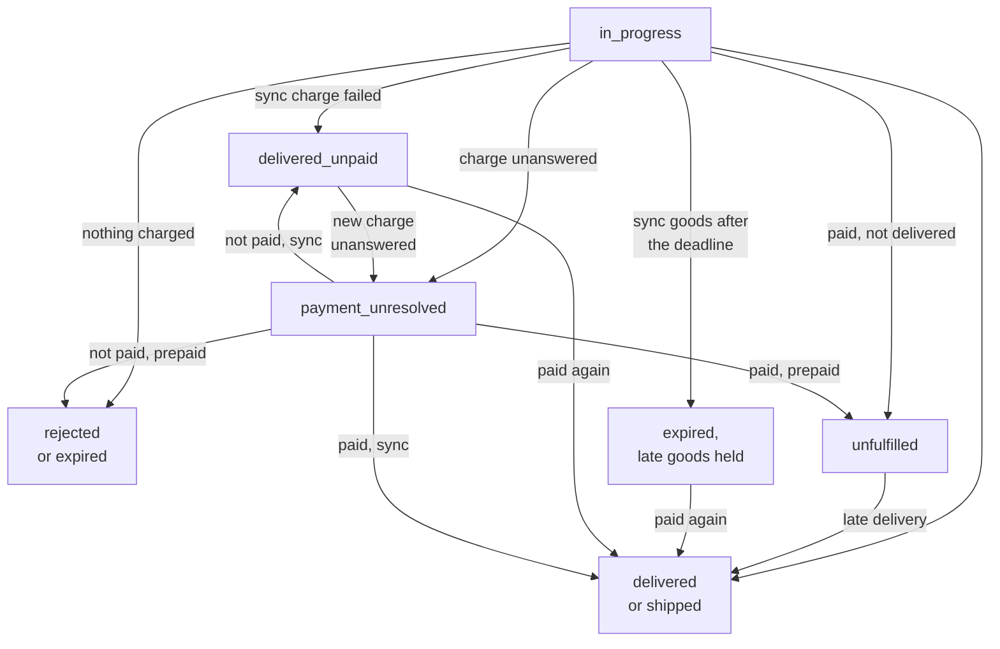
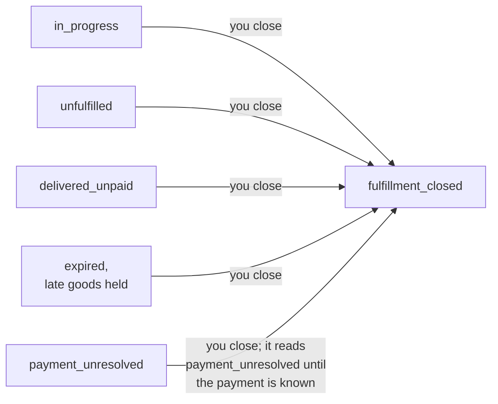

# Orders and fulfillment modes

*This page describes `@nuanu-ai/agentify` {{sdk-version}}. A change to the public contract arrives in a new package version.*

You are writing the handler that takes paid orders and gives out the goods for
them. This page is its reference: the fulfillment modes, where an order comes
from, what your handler answers, how an order can end, and every time limit
that applies to it. The working words — card, handler, idempotency key — are
defined on [The first test sale](/quickstart), and the failures are collected
in one table on [What can go wrong](/failures).

## Fulfillment modes

| Mode | When the buyer is charged | The goods reach the agent | If you refused or stayed silent |
| --- | --- | --- | --- |
| Synchronous, `'sync'` | after your delivery, as the last step | in the answer to the purchase | the purchase did not happen and the buyer spent nothing |
| Asynchronous, `'async'` | at the moment of purchase, before your delivery | later, by a separate call | the money is in your payout contract and no goods were delivered: the order is `unfulfilled` |
| A parcel, `'ship'` | at the moment of purchase, before your shipment | with a carrier, once you record the shipment | as in the asynchronous mode |

The mode is declared in the card under `fulfillment`, and the agent knows it
before it pays. There are three: synchronous, asynchronous, and a parcel, which
is published on the test channel only. The product decides the mode; which one
yours takes is worked out on [The product card](/cards#goods-that-leave-later-than-the-answer),
and what the moment of charging means for the owner of the business is on
[Money](/money).

### A parcel

A parcel's order is the asynchronous one with an address in it and a shipment
at its end; what its card asks of you is on [Cards](/cards).

Your price handler is asked the price for the place the parcel goes: its
`ship_to` holds the country and the city, the state and the postal code where
the buyer gave them, and nothing about who receives it. Once the order is
paid, it reaches your handler with the whole address in `ship_to`: a name, the
first line, the city, the country and a phone number, and the second line, the
state and the postal code where the buyer gave them. Store the address before
you take the order on: the moment you answer `accepted`, or the order ends
without you, Agentify erases its copy, the order reads only
`ship_to: { erased_at }` from then on, and it is never handed to your handler
again.

When a carrier has the parcel, record the shipment with the same `deliver`
call that delivers goods elsewhere, or answer your handler with it as
`delivered`. Its body is the shipment: `carrier`, the carrier's name or your
own courier; `tracking_number`, or `null` where the parcel has none; and,
where you have them, `tracking_url`, an https page on the carrier's domain,
and `estimated_delivery` with its `earliest` and `latest` instants. Agentify
records the instant the call arrived. The same shipment sent again succeeds,
and a different one is refused with `shipment_already_recorded`: a recorded
shipment cannot be changed. The agent then reads the order as `shipped`, with
your shipment beside it, and that is the last word Agentify has about the
parcel — whether it arrives is between you and the buyer, who is pointed at
your shop's site.

A parcel not shipped by its deadline is `unfulfilled`, and a late shipment can
still be recorded until you [close fulfillment](#closing-fulfillment). Parcels
are not sold on the live channel yet.

## Where an order comes from

A purchase starts on our side. The agent finds the card and asks to buy it, we
work out the price — from the card, or from your price handler's answer — and
the facilitator, the service that verifies and executes payments, checks the
payment. Only after that does the order appear on your side, so invalid
purchases, stale prices and payments that failed their check never reach your
handler. The drawing shows one purchase in both kinds of mode.


### What an order is made of

| What | What it is for |
| --- | --- |
| `id` | the order's identifier, and its idempotency key: the same across every repeat |
| `merchant_item_id` | your own key for the product, the one it has in your database |
| `params` | the purchase parameters, already checked against the card's declaration |
| `price` | the sale price: `amount`, `currency`, `at` — the moment that price was fixed for this sale — and `as_of`, the moment the price it was worked out from was true |
| `price_id` | the identifier of the price question this sale came out of, absent where the card has no price check or the check went silent |
| `ship_to` | a parcel's address, and only on a parcel's order |
| `test` | `true` on the test channel, `false` on the live one |

Say an agent buys a month of access. What reaches your handler is your own
`access-monthly`, the email address the agent gave at purchase, an order
identifier of the form `ord_7c1e05a9c4d84f0b9e2d6c3b1a8f5e47` — by which you
recognise this same order if it arrives again — and the sum the access was
sold for.

The price is in the order because the sale may not have gone at the card's
price: where a product has a price check, it went at the check's answer. That
is enough to record the sale on your side without looking the card up, and
there is no need to compare it against your own price list: we catch a
mismatch before the order leaves for you. On a card with no price check the
price is fixed the instant the agent asks to buy, and its `as_of` is when that
card price was published; on a card with a price check it is fixed when your
answer comes back, and its `as_of` is what your answer said. Neither is the
payment time recorded on [the receipt](#the-receipt).

The order does not say which mode it was sold in, and it does not carry the
card's `result`. A process that sells products in more than one mode tells
them apart by `merchant_item_id`, and answers with the goods or with
`accepted` accordingly.

The field `price_id` ties the order to your own answer about the price: if you
set stock aside against the price you named, this is the moment to write it
off. The identifier is good once, and no second order arrives under it.

### What a handler can answer

A handler has three answers:

- a delivery — JSON to the result declared in the card; the order ends as a
  success;
- a refusal — a short code and a reason a person can read, with the codes
  collected in the [vocabulary of refusal codes](/cards#refusal-codes);
- taking the order on, where the goods leave later: you confirm the delivery
  itself with a separate call. That call does not exist in the synchronous
  mode, so a synchronous handler that answers this way is refused with
  `not_applicable_in_mode`, and the order ends when its seconds run out with
  the buyer charged nothing.

The same three exist as calls you make from outside a handler — `deliver`,
`refuse` and `accept`. A fourth call, `close`, is not an answer: it stops
Agentify accepting deliveries for an order ([Closing
fulfillment](#closing-fulfillment)).

Those three answers are the whole set, and that matters for how you report a
temporary failure. An exception in the handler, a process that fell over, a
connection that broke — for us each of these means the order never reached
you, so we send it again, after a delay, until the order's deadline runs out
or we have delivered it five times, whichever comes first. Five is what this
system is set to, and no card changes it. Once we stop sending it, the order
stays open until its deadline: an answer or a delivery that arrives before
then still counts. A refusal we read the other way, as a final "this cannot be
delivered", and we end the order on it. So a supplier that did not answer in
time is not worth a refusal: throw instead.

We wait three seconds for a handler's answer, counted from the moment we hand
the order to your process. An answer that comes later still counts while the
order's deadline has not run out, but by then the order has gone out again,
to the same process or to another instance, and the repeat is answered the way
every repeat is ([Telling a repeat apart](#telling-a-repeat-apart)). That is
why an asynchronous handler takes the order on at once and does the work
outside the handler, and why a synchronous handler slower than three seconds
has to expect the same order twice.

## Confirming a delivery with a separate call

You finish an order you took on with `deliver`, once the delivery is done.
The call is made on the order itself — the object that arrived in your handler,
or the one you read back from us — and it takes one argument: the result, to
the shape declared in the card, which goes to the agent as it is.

```ts
await order.deliver({ access_url: url, expires_at: until })
```

A delivery carries exactly what the card's result declared when the agent
asked to buy: every field it promised, in the type it names, and nothing it
does not name ([Delivery result](/cards#delivery-result)). The order keeps
that promise from the moment it is made, and it does not carry the promise to
you: after you republish a card with a different result, the orders already
taken are still held to the old one, so deliver to them what they were sold
with, or wait until they have ended before changing the shape. Goods that do
not fit are refused with the offending fields named, and the order does not
move at all — nothing of what you sent is written down, no receipt is issued,
and no deadline of yours moves.

That refusal also says whether the order is still there to finish, so read it
before you make the goods again. An order still yours to finish is refused
with the words that it stands where it did, marked as worth calling again:
fix the handler and deliver. An order that has ended is refused with its
ending named and marked as not worth calling again, and the fields that did
not fit are still listed; a handler that ignores that mark makes the goods
once for every attempt.

The call is idempotent by the order's identifier. Call it a second time with
the same `order.id` and it succeeds again, marked as already delivered: no
second delivery happened and no second charge. `ok` is true in both cases, so
you do not have to branch on the word inside it, which is there when you want
it. A repeat is not weighed against the card, because there is nothing left
for it to write: what it carries is neither checked nor kept.

A delivery after the deadline still counts. Past its deadline a paid order
reads `unfulfilled`, and a late `deliver` makes it `delivered`, or `shipped`
for a parcel, with `ok` true and the word `delivered_late`. Once you close
fulfillment of the order, a late `deliver` is refused with
`fulfillment_closed`.

## Refusing after you have taken the order on

Taking an order on does not bind you: while the order is open, you can refuse
it with a separate call. In the synchronous mode the handler refuses in its
own answer, and there is no separate call there at all.

```ts
await order.refuse({
  code: 'out_of_stock',
  message: 'The supplier did not confirm the number',
})
```

The buyer has already been charged for an order you took on, so a refusal
makes it `unfulfilled` straight away. It stays on the open list, and a late
delivery still counts. A refusal does not stop Agentify accepting deliveries;
closing fulfillment does.

## Closing fulfillment

Close fulfillment when Agentify must stop accepting deliveries for an order:
you refunded the buyer, agreed something else with them, or fulfilled the
order outside Agentify. Closing records that you decided so. It moves no
money, confirms no refund and does not judge whether the buyer's claim is
settled.

```ts
const order = agentify.orders.forId(savedId)
await order.close()
```

You can add an explanation for the buyer, which its agent reads as your words:

```ts
await order.close({ message: explanationForBuyer })
```

The message is held to the same [plain-text
rule](/cards#the-words-on-a-card-are-plain-text) as a card's description: no
HTML markup, no character references, no control characters or direction
overrides, line feeds allowed, at most 2000 characters. A message that breaks
the rule is refused before anything is recorded, with words naming what is
wrong.

The dashboard offers the same action under **Orders → Order details → Close
fulfillment** for every order the buyer has paid or may have paid, SDK and
WooCommerce orders alike, and it changes nothing in a WooCommerce shop.

What `close` does depends on where the order stands:

| The order | What `close` answers | What follows |
| --- | --- | --- |
| still open — `in_progress`, `unfulfilled`, `delivered_unpaid` — or `expired` with late goods held for a repeat purchase | `{ ok: true }` | it reads `fulfillment_closed`, a late `deliver` is refused with `fulfillment_closed`, goods held for it are never released, and it leaves the open list |
| `payment_unresolved` | `{ ok: true }` | it reads `payment_unresolved` until the payment is known, then `fulfillment_closed`; if the payment went through, you are sent `order.unfulfilled` and the order is on the open list again |
| already closed by you | `{ ok: true }` | nothing changes: the first time and message stay, except after a payment that went through once you closed (below) |
| delivered or shipped | `fulfillment_complete`, not retryable | nothing changes, and the receipt stands |
| ended with nothing charged and nothing held: `rejected`, `expired` | `nothing_to_close`, not retryable | nothing changes, and the agent keeps the reason it was given |

Closing cannot be undone, and it cannot recall work your handler or your shop
has already started, so stop that work in your own system. Like `deliver`,
`close` is idempotent by the order's identifier: after a lost answer, call it
again or read the order back. An order of another merchant is answered as if
it did not exist.

A charge Agentify had already sent to the facilitator when you closed can
still go through, because closing cancels no payment. If it does, the order
keeps `fulfillment_closed`, its `payment_status` becomes `paid`, you are sent
`order.unfulfilled` with the reason `paid_after_closure`, and the order is on
the open list again.

Your earlier message may now be wrong. Once you have settled things with the
buyer, close the order again with a message that says what you did: that
closure records its own time and message and takes the order off the list.
Closing never releases goods held for the order and never lets the buyer pay a
second time.

After closing, the order you read back carries
`merchant_closure: { closed_at, message? }` beside its
[`payment_status`](#finding-out-where-an-order-stands). It keeps its price,
payment and history, and records no refund amount. On a paid order the agent
reads, beside your message, a sentence of Agentify's own: the order was paid,
you closed fulfillment, and Agentify confirms no refund.

## When a call on an order does not go through

`deliver`, `refuse`, `accept` and `close` hand their failures back rather
than throwing them, unless the client was built with no address: `ok` is
false, and one `error` beside it carries a code to branch on, a sentence a
person can read, and `retryable`. Ten codes are promised to mean one thing
each — seven sent by us, and three the tools produce when no answer they could
read came back. The set is open beyond those ten, so a case nobody anticipated
reaches you in its own words.

| Code | When it arrives | Repeating could change it |
| --- | --- | --- |
| `fulfillment_closed` | you closed fulfillment of this order, so a delivery is no longer accepted | no |
| `fulfillment_complete` | `close` on an order whose goods were delivered or whose parcel's shipment is recorded; the order was not changed | no |
| `nothing_to_close` | `close` on an order that ended without a charge and holds nothing for its buyer; the order was not changed | no |
| `order_already_closed` | the order has ended, and no call reopens it | no |
| `not_applicable_in_mode` | the call or the answer does not exist for this card's mode: in the synchronous one the handler's own answer is the delivery or the refusal | no |
| `delivery_does_not_match_card` | the goods are not the ones the order was sold with, so nothing was written down | while the order still stands, yes — with different goods; once it has ended, no |
| `shipment_already_recorded` | a parcel's shipment is already recorded on this order, and a recorded shipment cannot be changed; the same shipment sent again succeeds | no |
| `call_did_not_reach_us` | the call never got to us, so it did nothing | yes |
| `answer_not_understood` | it reached us and came back in words these tools cannot read, so it may well have done its work | yes |
| `outcome_unknown` | it went out into silence — the connection broke, the process was stopped mid-call — and nothing on your side knows whether it landed | yes |

The flag says that repeating the call could change the outcome, which is not
the same as saying that repeating is safe. `deliver`, `accept` and `close` are
idempotent by the order's identifier, so for them it is both; `refuse` is not,
so read a refusal that failed back with `get` before sending it again. A code
outside those ten is most often us refusing the call at the door — a key we
will not take, an order identifier that names nothing — under our own word,
such as `not_authorised` or `no_such_order`, with `retryable` false.

Where the error is about the goods you sent, what did not fit travels as
findings in `error.problems`, and that list is the complete account: one
finding per declared field you got wrong, with its path, a code and words a
person can act on, and one finding with an empty path for every field your
card never declared. The `message` beside the list is a single line for a
log, which may be cut short and says where. Print that to a person; branch on
the list.

## Finding out where an order stands

Every order carries a `status`, which `orders.get` and `orders.list` return
and which the agent reads too. The drawings show how the words follow one
another, and the table after them is the one to write a `switch` from.



Closing fulfillment leads to one word from every status that still has
fulfillment to stop:



| `status` | What it means | On `orders.list({ open: true })` | What a loop over open orders does |
| --- | --- | --- | --- |
| `in_progress` | the purchase has not finished: priced, paid, with your handler, or taken on | once it is paid | on an asynchronous order or a parcel, delivers if your own record says the goods are ready; on a synchronous one, nothing, since your handler answers it |
| `delivered` | the goods are the agent's and the money moved | no | — |
| `shipped` | a parcel's shipment is recorded and the money moved | no | — |
| `rejected` | nothing was charged: your price check said there is none, or stayed silent on an asynchronous card or a parcel; a charge before the goods failed; or you refused a synchronous order | no | — |
| `expired` | a deadline ran out and nothing was charged: the price lapsed, or a synchronous answer did not arrive | no | — |
| `unfulfilled` | the payment went through and no delivery is recorded | yes, until you deliver or close fulfillment | delivers if your own record says to; otherwise leave it, or close fulfillment |
| `delivered_unpaid` | you delivered a synchronous order and the charge failed: the buyer has no goods and paid nothing | yes | skips it: a repeat purchase that pays releases the goods you made |
| `payment_unresolved` | nobody knows whether the charge went through | only after a synchronous delivery, and not once you closed fulfillment | skips it: Agentify settles it when the payment is known |
| `fulfillment_closed` | you closed fulfillment; `payment_status` says what became of the payment | only when a payment went through after you closed, until you close it again | skips delivering, which is refused; closes it again once you have settled with the buyer |

Where we rather than you ended an order and the word alone would leave the
agent guessing its next step, the status carries a `reason`. `rejected` comes
with `unavailable` (your price check said there is none),
`price_check_unanswered` (it did not answer in time, or its answer could not be
accepted) or `payment_not_settled` (the charge did not go through). `expired`
comes with `price_expired` (the price ran out before the payment was taken) or
`merchant_timed_out` (a synchronous answer did not arrive in time). A
`delivered_unpaid` order is still open and comes with `payment_not_settled`
too, so that the agent does not read the word as a delivery: the reason tells
it that nothing was taken, that Agentify holds the goods you made, and that
paying for the same purchase again from the wallet that signed it releases them.

Where the refusal was yours, your code and your message travel with the status
instead. An `unfulfilled` order carries a `reason` saying why nothing was
delivered: `refused` or `deadline_passed`. A payment confirmed
only after its own response deadline also reads `deadline_passed`, although no
deadline of yours passed. None of these words obliges you to refund.

Beside `status`, every order you read back carries `payment_status`, what
became of the original payment: `paid`, `not_paid`, or `unresolved` while
nobody knows. It is apart from the status because an order you closed can
still have been paid.

An order that ended `rejected` or `expired` with nothing charged or held is
deleted thirty days after it was last written, at the first daily clean-up
after that. From then on `orders.get`
refuses it with `no_such_order`, as an order that never existed, it is no
longer in `orders.list`, and the agent's status address answers it as an
unknown order. Your dashboard lists such
orders apart, under Lapsed. An order with a payment, a claim on a payment, a
receipt or goods held is never deleted.

On the orders you read back, `status` and `payment_status` are the words in the
tables above and one more, `unknown`: a word Agentify added after your release
of the SDK was built. It is none of the endings, so leave such an order for a
later pass and upgrade; [When Agentify is newer than your
package](#when-agentify-is-newer-than-your-package) says what else a newer
Agentify changes for you. A loop that delivers does so only on the words where
delivering is right, so a word it does not know is left alone, as below.
Because an order left alone that way may be paid work waiting on you,
`orders.list` tells your problem handler how many of the orders it returned
carry a status your package does not know, in one `unread` problem that is not
fatal. It decides nothing about those orders; upgrading the package is what
reads them.

```ts
const order = await agentify.orders.get(orderId)
const open = await agentify.orders.list({ open: true })

for (const waiting of open) {
  // Deliver only where delivering is right: an order still running, or paid
  // and unfulfilled. Every other word waits for a later pass, `unknown`
  // included, which the package has already counted for your problem
  // handler: goods held for a payment wait on the buyer, and an order paid
  // after you closed it needs your word to the buyer, not goods.
  if (waiting.status !== 'in_progress' && waiting.status !== 'unfulfilled') {
    continue
  }

  const issued = await accessFor(waiting.id)

  if (issued !== null) {
    // Your own record decides whether to deliver. A synchronous handler
    // answers its own in-progress order, and an order you closed refuses it.
    await waiting.deliver({ access_url: issued.url, expires_at: issued.expiresAt })
  }
}
```

The first call returns one order, the second every order still open. They are
for the case where your process restarted and no record of the order is left
on your side, and they carry the same `deliver`, `refuse` and `close` as an
order your handler was given. Neither has a failure branch to hand you, so when they
cannot reach us they throw, as an `AgentifyError` carrying a `code` and the
`route` it happened on — worth remembering about a loop that runs the moment a
process comes back up.

An order the agent was given a price for and has not paid is not on the open
list, because it never reached your handler: delivering against it would make
goods for a purchase that never happened. A loop over the list therefore rests
on your own record of what you have already sent. One that makes the goods
afresh for every order it finds will issue a new code, be told it succeeded,
and lose it ([Telling a repeat apart](#telling-a-repeat-apart)).

If your own record of the order survived and holds our identifier — a job in a
queue, a row in your database — the order can be assembled from it without
asking us anything. That call works even when we cannot be reached: it reads
nothing, and a delivery against it goes out and comes back as an error flagged
worth repeating.

```ts
await agentify.orders.forId(savedId).deliver({ access_url: url, expires_at: expiresAt })
```

## Events on the same subscription

Besides orders, the same subscription carries events: messages about something
that happened to an order without you. A handler for them is declared with
`agentify.on('event', ...)`, and it sends nothing back.

| Event | `type` | What it carries |
| --- | --- | --- |
| A paid order was left unfulfilled | `order.unfulfilled` | `order_id`, `at`, the original sale `price`, and a `reason`: `refused` after the charge, `deadline_passed`, or `paid_after_closure` for a payment that went through after you closed fulfillment |
| A payment did not execute after a synchronous delivery | `order.payment_failed_after_delivery` | `order_id` and `at`; the order's own status says whether the charge failed or went unanswered |

An event is sent once and never again, which is the opposite of the rule for
orders. Your answer is what acknowledges an order, so we can send it again when
it did not arrive; an event asks for no answer, so one that went into a poll
response your process never received is simply gone, and nothing afterwards
says so. The guard an order needs is against a repeat, and the guard an event
needs is against a silence.

A lost notice must not hide a paid order without its goods. Every such order
stays on the open list until you deliver or close fulfillment, and an order
you closed comes back to it when a payment goes through afterwards, so walking
that list finds what a lost event would otherwise hide. Walk it on a schedule
and not only after a restart.

## You delivered and the payment did not execute

A rare case, and possible only in the synchronous mode. We check a payment
first and execute it as the last step, after your delivery, and between the
check and the execution the funds can leave the buyer's wallet for something
else.

You have produced the goods, and the charge either failed or never answered.
The goods are recorded, the event above goes out to you, and the order stays
on the open list whether the event arrived or not. The agent receives the
goods only once the payment is known to have gone through.

The order's status tells the two cases apart. Where the charge came back
failed, the order reads `delivered_unpaid`: the same buyer can pay for this
order again, and if that payment goes through, the goods you made are released
and the order ends without another call to your handler. Where the
facilitator never answered, the order reads `payment_unresolved`, described in
the next section.

In both cases the goods are already recorded on our side, so a second delivery
is answered as a success and nothing it carries is written down. Whether to
revoke what you gave out or to wait is yours to decide. The risk is bounded by
the price of one purchase, and the owner of the business is told about it on
[Money](/money).

## When nobody knows whether the charge went through

An order reads `payment_unresolved` when Agentify sent the charge and the
facilitator never said whether it went through. Another payment for the order
is refused meanwhile, because a second charge on top of one nobody has heard
from would spend the buyer's money on a guess.

The payment the agent signs authorizes one transfer from its wallet, valid for
a short window, and that transfer either happened on the Base network or did
not. After the payment's response deadline, Agentify looks for it there in the
background, without sending another charge; a late answer from the facilitator
settles the order as well. What it finds decides where the order goes:

| What Agentify finds | A synchronous order you delivered | An order charged at purchase | An order whose fulfillment you closed |
| --- | --- | --- | --- |
| the transfer happened | `delivered`: the goods are released and a receipt is written | `unfulfilled`, and you are sent `order.unfulfilled`; the order never reached your handler, so deliver it from the open list or close fulfillment; a parcel's address is erased by then, so close it | `fulfillment_closed` with `payment_status: 'paid'`, and you are sent `order.unfulfilled` with `paid_after_closure`; no goods are released |
| the transfer can no longer happen: the authorization was cancelled, or its window passed unused | `delivered_unpaid`, and the buyer can pay again | `rejected`, with the reason `payment_not_settled` | `fulfillment_closed` with `payment_status: 'not_paid'`; the buyer cannot pay again |

Until Agentify finds one or the other, the order stays `payment_unresolved`.
A network that cannot be read, evidence that contradicts itself or a
transaction hash on its own settles nothing. The search carries on across
restarts and needs nothing from you.

No time is promised for it. Both channels read the network through a free
public service, which can turn requests away for long stretches, so an order
can stay unresolved for a long time, and nobody at Agentify settles it by hand
meanwhile.

## How an order can end

Most orders end with a delivery, a refusal or a deadline, and the agent sees
which. The table also holds the rarer endings, where the payment is unknown or
you closed fulfillment, and its `status` column is the word each one reads.

| Situation | `status` | Where the money is | What the agent sees |
| --- | --- | --- | --- |
| You delivered the goods | `delivered` | in your payout contract | the goods, the price they were charged and whether the money behind it was real |
| You recorded a parcel's shipment | `shipped` | in your payout contract | that the parcel shipped, with your carrier, your tracking number and when you recorded it — and nothing after |
| There is none, or you refused in the synchronous mode | `rejected` | never moved | a refusal, and that the purchase did not happen; where the refusal was yours, your code and your message arrive with it |
| Time ran out: the price lapsed before the payment, or no synchronous delivery arrived | `expired` | never moved | the order ended on its deadline |
| The money was charged and no delivery happened | `unfulfilled` | in your payout contract | no delivery is recorded, and Agentify confirms no refund |
| You delivered synchronously and the payment did not execute | `delivered_unpaid` | never arrived | the reason `payment_not_settled`: nothing was taken, Agentify holds the goods, and paying for this same purchase again from the same wallet releases them |
| You closed fulfillment | `fulfillment_closed`, or `payment_unresolved` while the payment is unknown | where `payment_status` says: in your payout contract when `paid` | that you closed fulfillment, with your message as your words, and on a paid order Agentify's own sentence that no refund is confirmed |
| The facilitator did not say whether the money was charged | `payment_unresolved` | unknown until Agentify finds the transfer or proof it cannot happen | "the outcome of the payment is not known", not "refused": another payment is refused while the first is unknown |

A purchase whose parameters do not fit the card is refused at the door, before
any order exists, and a payment that fails its check is refused the same way,
leaving the priced order to lapse as `expired`. Two more refusals come before
anything is charged, both described on [What can go wrong](/failures): a
purchase while twenty of yours already wait for payment, and a purchase that
charges before its goods while no process of yours has polled for ten minutes. A pause ends no orders: cards
stop selling, and the orders already taken on play out in the ordinary way.
To stop Agentify accepting deliveries for one order, [close
fulfillment](#closing-fulfillment).

## Every time limit

Every wait has a limit, and an order that runs past it closes or moves on
without you. The limits are ours to set, the same for every merchant, except
the two your card names.

| What waits | Whom it binds | How long | Counted from | When it runs out |
| --- | --- | --- | --- | --- |
| Your price handler's answer | you | five seconds | the question is asked | a synchronous card sells at its own price; an asynchronous card or a parcel is refused before payment (`rejected`, `price_check_unanswered`) |
| The price an order was given | the agent | thirty seconds | your answer; on a synchronous card, the silence of your price check; on a card with no price check, the agent's request | the agent asks for a fresh price (`expired`, `price_expired`); no order reaches you |
| Each hand-over of an order to your process | you | three seconds | the order is handed to your process | the order is sent again, up to five deliveries in all, within its own deadline |
| The goods of a synchronous order | you | ten seconds | the payment checked out | nothing is charged (`expired`, `merchant_timed_out`); goods that arrive later are released if the same buyer repeats the purchase and pays, unless you closed fulfillment |
| The facilitator's answer about the charge | Agentify | ten seconds on a synchronous order; fifteen where the charge comes before the goods | the charge is sent | `payment_unresolved` |
| The delivery of an asynchronous order | you | the deadline your card names; without one, a day | the charge at purchase | `unfulfilled` |
| The shipment of a parcel | you | your `ship_within_seconds`, at most thirty days | the charge at purchase | `unfulfilled` |

The agent is promised a synchronous purchase within twenty seconds of the
payment check, and your ten seconds and the facilitator's ten fit inside them.
Asking your price comes before the payment, so it is outside all three
numbers. A late synchronous answer is not an error and does not come back as
an exception: the purchase has already ended with nothing charged, and goods
that fit the card are kept for a repeat purchase without your code being told.

## Telling a repeat apart

By the order's identifier: it is the same across every repeat, and your side
answers with the earlier result under it instead of delivering a second time.
Orders are delivered at least once, so a repeat is ordinary traffic; it does
not mean that anything broke. On the agent's side we recognise a repeat by the
payment: the payment request we issue names the order by a payment reference,
separate from its identifier, and that reference comes back in the payment the
agent signs, so a repeat names the order it repeats and we carry that order on
from where it stopped.

To recover a lost answer, the agent signs a new payment for that same payment
request from the same wallet, and once Agentify has checked that signature,
without asking the facilitator and whatever the wallet holds now, the agent
receives the original purchase without a second charge. Asking the purchase
address again without that kept payment request starts a new purchase, which
is charged again once paid, so recovery always signs the kept request again. The payment
reference is public and opens nothing by itself: a payment already used, or one whose
window has passed, sent again reveals neither the order nor where to read it.

The rule to hold yourself to is that the goods on a repeat are the goods you
sent the first time. What the buyer keeps is the first delivery: a later one is
answered as a success, and whatever it carries is neither written down nor
handed to the agent. So a handler that makes the goods afresh on every attempt
— a new access code each time — leaves the buyer holding the first code while
your own records say the second one was spent, and nothing in our answer shows
you that.

A repeat of an asynchronous order you have already delivered is answered with
what you answered the first time, taking the order on; there is no need to
call `deliver` again, because the order has already ended. Answers that are
not the goods may differ freely between attempts.

## Running the handler in several instances

One delivery of an order goes to one instance. Run the handler in three
processes and three subscriptions divide the stream between them, and each
delivery lands in one of them.

Your answer is what acknowledges an order: until it comes back, the order
counts as open. A process that fell over or reconnected without answering
leaves the order to go out again, possibly to another instance, and so does a
handler that takes longer than the three seconds we wait for an answer. In that
second case the same order is in two processes at once, which is ordinary, and
it is what the handler's idempotency by the order's identifier is for.

Within one SDK instance, up to four messages can be unfinished at once. A slow
order handler lets another order or price question run while there is room.
When all four places are occupied, the instance asks for nothing more until
one finishes, so a price question can still wait behind slow work. More
instances divide the stream further.

Handlers for different orders may overlap and finish in a different order.
Within one instance, an order event waits for earlier handlers for the same
order. A repeat of an order already running there shares that attempt; once
it finishes, or in another instance, the order can call your handler again.
Your fulfillment still needs idempotency by the order's identifier. `stop()`
waits for handlers already taken on, including events waiting on that order;
it does not fetch more work.

## Test orders

A test order carries `test: true`, which is how a handler tells a rehearsal
from a live sale: send such an order into your own test environment, answer
with a stub, or serve it like any other. The flag follows the chain the
payment settled on rather than the key you called with, so every order from
the test channel at `https://test.agentify.ad` reads `true` and every order
from the live channel at `https://agentify.ad` reads `false`. A process
pointed at the test channel sees test orders and nothing else, so the same
handler can stop short of real provisioning where the flag is true without
ever stopping short of a live sale.

The price question that comes before an order carries no flag of its own. It
comes from whichever channel your client is pointed at.

## The receipt

A paid sale leaves a receipt when its goods are released or its parcel's
shipment is recorded; the dashboard's Receipts screen shows them, and
`GET /v0/receipts`, called with your key as `Authorization: Bearer <key>`,
returns them to your code, though the SDK has no method for it.

A receipt follows the goods, so a payment nobody knows the outcome of has
none, and neither has a paid order that was never delivered or shipped,
including one you closed. A payment found after its deadline writes a receipt
only where it releases goods already held, and never once you closed
fulfillment. Receipts therefore do not account for all the money you
received. The buyer's status names the transaction of every paid order under
`transaction` once its payment has gone through, so a payment whose goods are
still to come can be proved without searching the chain for it.

| Field | What it is |
| --- | --- |
| `id` | the receipt's own identifier |
| `order_id`, `item_id` | the order and our catalogue identifier for the card that was bought |
| `price` | the price the sale went through at, which stays as it was after your price moves: `amount`, `currency`, `at` — when we fixed it for this sale, "Price set" in the dashboard — and `as_of` — when that price was true, "Price as of" |
| `paid_at` | when the facilitator confirmed payment, or, for a payment Agentify found on the network afterwards, the time of the block that holds its transfer; "Paid" in the dashboard |
| `transaction` | the hash of the buyer's transfer into your payout contract, as the facilitator reported it or Agentify found it, which the dashboard links to the chain's explorer; absent where no transaction was recorded |
| `test` | `true` for a test purchase, which is not proof that real money moved |

The three moments can differ: in the synchronous mode the charge follows your
delivery, and a price check can describe a price from earlier. The transfer a
receipt names goes into your payout contract and not into your wallet, which
receives one transfer per payout instead.

## When Agentify is newer than your package

Agentify adds to what it sends without waiting for you to upgrade, and the
package you installed reads past what was added:

- A field your package does not know, on an event, a card, a receipt, around an
  order or in any other answer that only informs, is left out of what your code
  receives, and everything else in that answer arrives as before. What an order
  delivers is the exception, below.
- An event of a kind your package does not know is skipped. The rest of the
  poll it came in is handled as usual, and your problem handler receives one
  `event_skipped` problem, not fatal, naming the event's `type` and saying that
  a newer release handles it. An event can be lost in any case, as [Events on
  the same subscription](#events-on-the-same-subscription) says, so nothing
  depends on it: a paid order that needs you stays on `orders.list({ open:
  true })` whether its event arrived, was lost or was skipped.
- An order whose `status` or `payment_status` holds a word your package does
  not know still comes back from `orders.get` and `orders.list`, with that word
  as `unknown`. A loop over open orders that delivers only on `in_progress` and
  `unfulfilled` leaves such an order alone, which is the right thing to do,
  and `orders.list` gives your problem handler one `unread` problem, not
  fatal, counting such orders among those it returned and saying that a newer
  release reads them, since paid work may be waiting among them.
- An event of a kind your package knows, with a `reason` it does not know,
  reaches your event handler with the reason as `unknown`; the order behind it
  is on the open list as ever.
- A delivery, refusal or acceptance answered `ok: true` with a `result` word
  your package does not know succeeded, and the word reads `unknown`.
- A price question for a `purpose` your package does not know is left
  unanswered, with one `quote_skipped` problem, not fatal. It counts as a
  silent price check: a synchronous card sells at its own card price, and in
  the other modes the sale is refused ([What can go wrong](/failures)).

What an order delivers is read exactly: its product, parameters, price,
address and test flag, off the subscription or read back, because an order
handed to your code with part of it missing would be delivered wrongly without
a word. On the subscription, an order carrying a field or an address shape
there that your package does not know is not handed to your handler. Your
problem handler receives one `unread` problem, not fatal, with the order's
identifier as its `subject`, naming each field it could not read and saying
that a newer release reads it, and everything else in that poll answer and in
the polls after it is handled as usual. Nothing is answered for that order, so
it comes again within its attempts, and once paid it stays on the open list.
Read back, the same order fails `orders.get`, and fails `orders.list` as a
whole, with a thrown `AgentifyError` that names the fields.

A message on the subscription that does not fit for another reason, such as a
timestamp that is not one, is set aside in the same way with an `unread`
problem naming where it failed. That problem does not say a newer release reads
the message, because nothing on your side can tell a broken message from one
written in a shape added later. Neither problem, nor any failure your package
reports about an answer it could not read, repeats what that answer carried:
the buyer's parameters and the prices stay out of your logs, and only the
names of the fields and what was expected there are given. An answer that is
not JSON at all, such as a proxy's error page, is quoted, cut short where it is
long.

Agentify therefore speaks a new contract version for a change your package
cannot read past: a field or a word renamed or removed, a field that comes to
mean something else, anything added to an order or to a price question, and a
new card mode, selling state or kind of message on the subscription, each of
which is work or configuration an older package cannot do. The version is read
before anything else in a poll answer, so your subscription stops at the first
one Agentify sends in another version, whatever the messages inside it carry,
with a `contract_version_mismatch` problem naming both versions, once the
orders already in your handlers have sent their answers, or after fifty seconds
with a `batch_abandoned` problem naming those that did not. Only an answer
shaped as a poll answer, a version beside a list of messages, stops it. Anything
else that comes back, such as a proxy's error page that happens to name a
version, is reported as `poll_failed`, mentioning the version it named, and the
subscription keeps asking. Once stopped, your process stays up and sells
nothing until you upgrade.

Every call the package makes names its release to Agentify in its `user-agent`
header, as `agentify-sdk/` and the version, and Agentify notes it beside the
key's last use each time it writes that down, which is every few minutes at
most, so that we can see which releases are still in use. Nothing is refused
because of it.

## What is not settled yet

- The threshold at which a price counts as stale: any difference at all, or a
  difference larger than a named one.
- How long finding a payment whose answer was lost takes. No time is promised,
  and both channels depend on a free public service to read the network.
- What other events we send. The two named here are a minimum, and we add to
  the catalogue as cases turn up where your side would otherwise learn of
  something only by reconciling by hand.
- Telling your code that a synchronous answer arrived after its deadline. The
  answer carries the word; the tools drop it, because they report only the
  answers we refuse.
