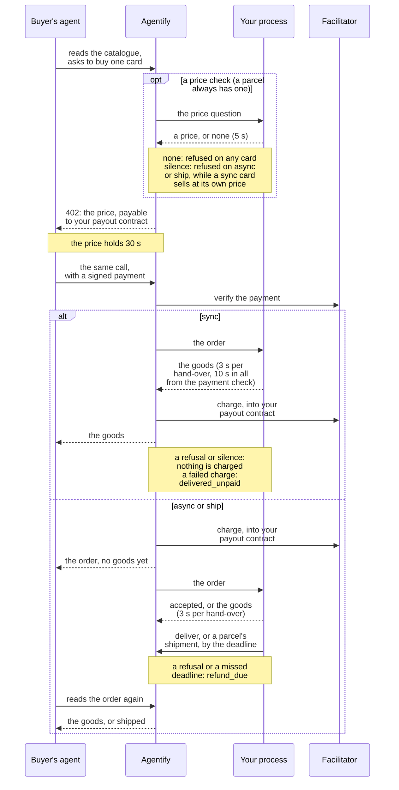

# The first test sale

*This page describes `@nuanu-ai/agentify` {{sdk-version}}. A change to the public contract arrives in a new package version.*

You are the one writing code here: the business has an API, and you want to
keep the delivery in your own hands. This page walks from an empty project to
a test sale you make yourself on the test channel, where the money is not
real: you publish a card, your handler takes the order and delivers, the buyer
receives the goods, and a receipt is written. You do not rewrite the shop to
get there: a handler appears beside it, in a process of yours that takes paid
orders and gives out the goods for them. A business that sells from a
WooCommerce shop has another route, without code, described on [Selling
through a WooCommerce shop](/woocommerce).

This is one purchase, from the catalogue to the goods, with your process in
it; each step below builds one part of it.



## The words used below

- Card — the description of a product in the catalogue that an agent decides
  from and buys through; its fields are in the [card reference](/cards).
- Order — the object that appears on our side after a purchase and arrives on
  yours; its whole life is on [Orders and fulfillment modes](/orders).
- Handler — your code, which receives orders and carries out the delivery, and
  your process, the program that runs it beside your API.
- Idempotency key — a string that is the same across every repeat of one order.
  Ours is the order's identifier, and your side answers with the earlier result
  under it instead of delivering a second time.
- Fulfillment mode — whether the goods arrive in the answer to the purchase or
  later, which decides when the buyer is charged. Three modes can be published:
  synchronous, asynchronous, and a parcel on the test channel only
  ([the modes](/orders#fulfillment-modes)).
- Price check — the question of how much a product costs and whether it is
  there, which we ask at the moment of purchase about products whose price
  moves. A price handler answers it, in your process beside the order handler.
- Facilitator — the service that verifies the buyer's signed payment and
  executes the charge; who is who in a sale is on [Connecting to
  Agentify](/#who-is-who).
- Pilot — the period Agentify runs in now, defined on [Connecting to
  Agentify](/#who-is-who); some rules hold only during it.

## 1. Make the merchant account ready

Open the [test dashboard](https://test.agentify.ad/dashboard/sign-in), enter
your email address, open the link in the message and press the confirmation
button. The dashboard then offers one button, "Open my seller dashboard"; its
press creates your merchant and asks for the seller name buyers will see. A
returning merchant reaches the same dashboard the same way.

In Settings, save the wallet where your share of the sales arrives: an address
on Base, `0x` followed by forty letters and digits. On the test channel it only
ever receives test USDC on Base Sepolia, so it needs no money of its own; if
your business has no wallet yet, [Money](/money#if-you-have-no-wallet-yet) says
how to get one. The wallet is set there and nowhere else: no key and no call
can change it.

Then open API Keys, press "Issue a key", give it a name of at most 100
characters that tells it from the next one, and copy it: the secret is shown
once. Keep it with your other secrets and out of source control.

Any key you issue can do everything your code can: publish cards, read orders
and receipts, take a card or all selling off sale and put it back, set your
seller name and site, and issue and revoke other keys. None of them can change
the wallet. So if a key leaks, revoke it on API Keys together with every key
you did not create yourself, and issue a fresh one for your code.

This step worked if Settings shows your seller name and your wallet and you
hold a key that starts with `csk_test_`.

## 2. Install the package and build a client

```sh
npm install @nuanu-ai/agentify
```

It runs on Node.js 24 or later. The release this page describes is named at
its top, and what changed between releases is in the
[changelog](https://github.com/nuanu-ai/agentify/blob/main/packages/sdk/CHANGELOG.md).
Keep the package current: the test channel can speak a change before it is
released, and during the pilot the contract's version does not move with each
change, so a release older than Agentify can read a word it does not know as a
failure.

The client needs a key and the address of the channel, and nothing after the
address: it adds the rest of the path itself. The test channel is
`https://test.agentify.ad`, and a key made on one channel does not open the
other.

```ts
import { createClient } from '@nuanu-ai/agentify'

const agentify = createClient({
  apiKey: process.env.AGENTIFY_API_KEY,
  baseUrl: process.env.AGENTIFY_URL,
})
```

The code on this page, but for the test buyer on step 6, also runs as plain
JavaScript. To try it in an empty project, put it in a file whose name ends in
`.mjs`, such as `agentify.mjs`, which lets Node read `import` and `await` at
the top of the file, and put the key and the address in a file named `.env`
beside it:

```sh
AGENTIFY_API_KEY=csk_test_...
AGENTIFY_URL=https://test.agentify.ad
```

Run it with `node --env-file=.env agentify.mjs`. The steps below are pieces you
add to that file, not one program to paste whole: `grantAccess`,
`startProvisioning` and `currentPriceOf` stand for your own code that makes the
goods and knows the price, and `savedId`, `url` and `order` in the later
snippets stand for values your code holds at that point.

This step worked if the client was built. A client built wrong is a
`TypeError`: with no key or with an address that is not an address at the line
that builds it, and with no address at all at its first call. Whether the key
and the address belong together is answered by the first call that reaches us,
on the next step.

## 3. Publish one card

```ts
const published = await agentify.catalog.publish({
  merchant_item_id: 'access-monthly',
  title: 'One month of access to the service',
  description:
    'What the buyer gets, what it is good for, and what is not included.',
  price: '5.00 USD',
  params: {
    email: { type: 'string', required: true, title: 'Where to send it' },
  },
  result: { access_url: 'string' },
})

if (!published.ok) {
  console.error(published.error.problems)
}
```

`merchant_item_id` is your own key for the product: an order arrives carrying
it, and publishing again under it updates the card rather than adding a second
one, so publishing can live in a script you run as often as you like. `params`
is what the agent has to give at purchase, and `result` is what it receives,
which your handler will return exactly. The card names no mode, so it is
synchronous. The [card reference](/cards) has every field, the short and long
spellings used here, and which mode a product takes.

This step worked if `published.ok` is true and `published.id` holds the card's
catalogue identifier, which the test purchase on step 6 buys by. If `ok` is
false, `error.problems` lists everything standing between the card and the
catalogue in one answer, each finding with a code, words a person can act on
and the path to the field where there is one. Four findings are about your
merchant rather than the card: `no_seller_name`, `no_payout_wallet`,
`no_seller_site` on a parcel's card, and `no_operator_approval` on the live
channel ([who checks a card](/cards#who-checks-a-card-before-it-is-published)).
Fixing what they name, not sending the card again, changes the answer.

A call that fails for another reason — a key we do not accept, an address that
does not answer — throws an `AgentifyError` with a `code`, such as
`not_authorised`, a `retryable` flag and the `route` it happened on.

## 4. Take an order and deliver the goods

Your process takes orders from a queue on our side through a subscription it
opens itself, over ordinary HTTPS to the address you gave the client, so it
needs no public address and no open port. You declare what it answers with
`on`, once for each kind of message — orders, price questions, events about
orders — and then open the subscription with `start`. Register one handler for
orders, either the synchronous or the asynchronous kind below, and call
`start()` once.

Register `agentify.on('problem', ...)` as well. It is where the tools tell you
what did not get through: a poll that failed, a handler that threw, an answer
we would not take, a message nobody handles. Without it those go to the
console, including the one that matters most: when Agentify speaks a version
of the contract your tools do not, the subscription stops and your process
stays up without selling.

While a WooCommerce shop connected in the dashboard sells for you, your
process receives no orders and every poll is refused with words that say so,
because a merchant sells through one of the two at a time.

### A synchronous handler

The card above is synchronous: the handler returns the delivery, or a refusal,
built on the order itself, and we send that answer for you.

```ts
agentify.on('order', async (order) => {
  const access = await grantAccess(order.params.email, {
    idempotencyKey: order.id,
  })

  if (!access.ok) {
    return order.refused({
      code: 'out_of_stock',
      message: 'No seats left on that plan',
    })
  }

  return order.delivered({ access_url: access.url })
})

await agentify.start()
```

Answer within three seconds of receiving the order where you can: a handler
still working after three seconds has the same order sent again, possibly to
another instance, and a synchronous sale is lost ten seconds after the payment
check, when nothing has been charged ([Every time
limit](/orders#every-time-limit)). A refusal and its message reach the agent
word for word, so write the message for a stranger.

### An asynchronous handler

A card with `fulfillment: 'async'` is charged at the moment of purchase, and
its goods come later. The handler starts the work and answers at once that the
order is taken on; write the order's `id` into your own record of the job and
deliver against it when the work is done, from anywhere in your code.

```ts
agentify.on('order', async (order) => {
  await startProvisioning(order.params.email, { idempotencyKey: order.id })

  return order.accepted()
})

await agentify.start()

// later, once the delivery is finished, against the id you wrote down:
await agentify.orders.forId(savedId).deliver({ access_url: url })
```

Return `accepted` within three seconds, which is how long we wait for a
handler's answer. The delivery deadline on your card is already running, from
the charge at purchase. A card that names none is held to a day.

If the delivery cannot be made after you took the order on, say so at once
rather than wait out the deadline; the buyer has paid, so the order then owes
a refund:

```ts
await order.refuse({
  code: 'out_of_stock',
  message: 'The supplier did not confirm the number',
})
```

`deliver` and `refuse` return their failures in the same envelope the publish
does, `ok` and an `error`, rather than throwing them, unless the client was
built with no address ([When a closing call does not go
through](/orders#when-a-closing-call-does-not-go-through)).

### A failure that may pass, and a repeat

A refusal is final. For a failure that may pass — a supplier that did not
answer, a database that was down — throw instead: the order counts as never
having reached you and comes again after a delay, and what you threw goes to
your problem handler and never to the agent.

Orders are delivered at least once, so the same order can reach your handler
again: after a network break, after your process restarted, after a retry of
ours. Pass `order.id` on as the idempotency key of your own delivery system and
answer a repeat with the result you gave the first time ([Telling a repeat
apart](/orders#telling-a-repeat-apart)). After a restart, the orders still
open can be read back from us ([Finding out where an order
stands](/orders#finding-out-where-an-order-stands)).

### Answering the price question

A card with `price_check: 'handler'` is sold at the price your price handler
names at the moment of purchase. It answers in the same process, down the same
subscription:

```ts
agentify.on('quote', async (q) => {
  const current = await currentPriceOf(q.merchant_item_id)

  if (current === null) {
    return q.unavailable()
  }

  return q.available(
    { amount: current.amount, currency: 'USD' },
    current.checked_at,
  )
})
```

The last argument, `as_of`, is the moment the answer is true for; left out, it
is the moment of the answer itself, so name the moment your cache was filled
when you answer from one. An answer of none starts no purchase. What a silent
price handler costs in each mode is on [What can go wrong](/failures).

This step worked if the process starts, its first log line names the test
channel and says the money there is not real, and your problem handler stays
quiet. The first order reaches it on step 6.

## 5. Check the card offline

```sh
npm exec --offline --package=@nuanu-ai/agentify -- agentify verify card.json
```

The check reads a card file the way we read it at publication and reports what
the contract can see from the card alone, without a key, an address or a
running handler. Run it from the project where you installed the package, so
npm uses that installation and never an unrelated package of the same short
name, and name the card files: called bare, it refuses and says why. The same
check is exported as `checkCard`, for cards assembled in code.

It answers `0` when every card it was given is complete as far as the contract
can tell, `1` when a card has findings, and `2` when it was called with
something it cannot work from, so a build script can stop on anything but `0`.
What it cannot see is your delivery: a purchase parameter your delivery needs
and the card does not name goes through unremarked, and whether your handler
holds against a repeat is proved by the purchase on the next step.

## 6. Make your first test purchase

You make the first purchase yourself, buying your own card on the test channel
with an ordinary x402 client, the payment protocol agents pay with. The buyer
needs a wallet of its own: a fresh private key you keep for test purchases and
nothing else, holding test USDC on Base Sepolia, which [Circle's
faucet](https://faucet.circle.com) gives away. It needs no ETH, because the
payment is an authorisation the buyer signs and the facilitator executes.

Install the x402 client and the library that signs with the key:

```sh
npm install @x402/core @x402/evm @x402/fetch viem
```

Then buy the card by the catalogue identifier step 3 returned, with the
purchase parameters the card asks for, and read the order until it has
finished. The program below is TypeScript whose types Node 24 can simply
erase, so save it as `buyer.mts` and run it with
`node --env-file=.env buyer.mts`, with two more lines in `.env`:

```sh
BUYER_PRIVATE_KEY=0x...
ITEM_ID=item_...
```


```ts
import { x402Client } from '@x402/core/client'
import { registerExactEvmScheme } from '@x402/evm/exact/client'
import { wrapFetchWithPayment } from '@x402/fetch'
import { privateKeyToAccount } from 'viem/accounts'

// The buyer's wallet, holding test USDC and nothing else.
const buyer = privateKeyToAccount(process.env.BUYER_PRIVATE_KEY as `0x${string}`)
const client = new x402Client()
registerExactEvmScheme(client, { signer: buyer })
client.setSpendControls({ maxAmountPerPayment: '$10' })
const payingFetch = wrapFetchWithPayment(fetch, client)

// What this program reads of the catalogue and of an order.
type Catalogue = { items: { id: string; purchase_url: string }[] }
type Order = { status: string; status_url: string; delivered: unknown }

// Your card in the test channel's catalogue, by the id step 3 returned.
const listed = await fetch('https://test.agentify.ad/x402/catalog')
const catalogue = (await listed.json()) as Catalogue
const card = catalogue.items.find((item) => item.id === process.env.ITEM_ID)
if (card === undefined) throw new Error('the card is not in the test catalogue')

const bought = await payingFetch(card.purchase_url, {
  method: 'POST',
  headers: { 'content-type': 'application/json' },
  body: JSON.stringify({ params: { email: 'you@example.com' } }),
})
// A refusal carries no order: print it rather than read it as one.
const answer = (await bought.json()) as Partial<Order>
if (typeof answer.status_url !== 'string') {
  throw new Error(`${bought.status}: ${JSON.stringify(answer)}`)
}
let order = answer as Order

// Goods that come later are collected at the order's own address.
for (let tries = 0; order.status === 'in_progress' && tries < 60; tries += 1) {
  await new Promise((resolve) => setTimeout(resolve, 5_000))
  order = (await (await fetch(order.status_url)).json()) as Order
}

console.log(order.status, order.delivered)
```

The purchase is a POST of the card's purchase parameters, `{"params":{}}` for
a card that asks for none, to the purchase address the catalogue gives for
the card. The client meets the 402 that names the price and your payout
contract, signs the payment and sends the same call again, and the answer is
the order: `status` says where it stands, `delivered` holds the goods once
they are the buyer's, and `status_url` is where it is read again.

It all came together if the order reached your handler, the buyer received the
goods — `delivered` here, with the `access_url` your handler returned — and the
purchase left a receipt on the Receipts screen of your dashboard. The order
carries `test: true`, because the test channel settles on a test chain.

## 7. Go live

The live channel is a separate account at `https://agentify.ad`, signed in to
the same way, with a wallet that receives real USDC on Base and a key that
starts with `csk_live_`. Nothing is copied from the test channel: your code
publishes its cards again with the live key and points the client at the live
address. Live publication also waits for an Agentify operator to approve your
merchant once; until then publishing lists `no_operator_approval`, and nothing
of yours sells live. A parcel's card is refused live (`not_sold_yet`). What
changes between the two channels is in one table on [Connecting to
Agentify](/#how-to-start).

## What is not settled yet

- A public way to ask for the operator's approval of the live channel.
- How to take orders outside Node. The subscription's wire protocol is not
  documented for external consumers; the ready-made tools are for Node only.
- The other ways of receiving orders, which are designed and not open: a
  request to an address of yours, and a cursor that pulls orders in batches.
- When we start calling a price hook, an https address of yours asked instead
  of your price handler, and what your side will check its requests against to
  know that they came from us.
- A check that sends one order twice and watches for a second delivery, so
  that holding against repeats could be proved without a purchase.
- Whether an external discovery catalogue lists a product whose sale settled
  on a test chain. Publication puts the card in Agentify's own catalogue, and
  no other listing follows from it or from a completed purchase.
